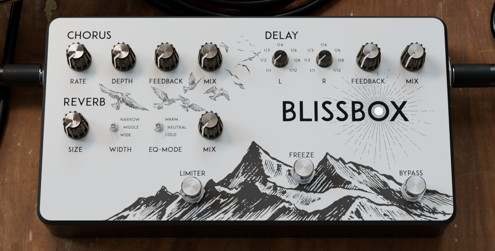
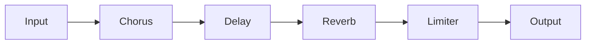

# BlissBox
A guitar pedal VST plug-in made with the [JUCE](https://juce.com/) framework.




## Overview

The BlissBox-Pedal was inspired by the Dispatch Master[^1] by Earthquaker Devices. It combines basic guitar effects, such as chorus, delay and reverb, into a blissful combination for easy use.
The chorus- and reverb-effect are implemented with the `juce::dsp::Chorus` and `juce::dsp::Reverb` modules. The delay-effect is based on a tutorial series[^2][^3] by 
[The Audio Programmer](https://www.theaudioprogrammer.com/). Additionally, the delay features bpm-synchronized times for two channels as well as dry/wet-mixing. To prevent clipping due to high feedback values a limiter provides a hard clipper. The freeze-footswitch puts the reverb into a continuous feedback loop and offers the possibility to generate drone sounds.

For rendering animations, the GUI implementation uses a Filmstripslider-class, based on the plug-in 
[Vib-rato](https://github.com/ColinGill/AudioPlugIn---Vibe-rato) by [Colin Gill](https://github.com/ColinGill/).

### The plug-in implements the following audio signal flow. 


## Building on Windows

Install Visual Studio C++ Build Tools with a Windows SDK and CMake (3.22 or
newer), plus Git. From PowerShell in the project folder, run:

```powershell
./build.ps1
# Optional debug build:
./build.ps1 -Configuration Debug
```

The CMake build pins JUCE 8.0.12 to commit
`29396c22c93392d6738e021b83196283d6e4d850`. It uses `external/JUCE` when
present; otherwise it downloads the pinned source during the first configure
(internet access required). Generated files stay in `build/`.
The script also finds CMake bundled with Visual Studio when it is not on PATH.

Release outputs are `build/BlissBox_artefacts/Release/VST3/BlissBox.vst3`
and `build/BlissBox_artefacts/Release/Standalone/BlissBox.exe`.
The build does not install the plugin into system folders.

The original Projucer project now uses relative image and module paths. To
use it, place JUCE at `external/JUCE`, open `BlissBox.jucer` in Projucer,
and regenerate its Visual Studio exporter. CMake is the verified build route.
The CMake build also downloads a pinned Microsoft WebView2 SDK (1.0.3485.44)
with SHA-256 verification. Windows users need the Microsoft Edge WebView2
Runtime installed; if it is unavailable, the plugin opens its classic editor.

## Browser interface

The top-right UI button switches between the original filmstrip editor and
the SVG-based browser editor. Both share all 15 existing APVTS parameters;
switching views does not reset the sound. The editor choice is saved with the
plugin state. HTML, CSS, JavaScript, and the supplied SVG are embedded in the
plugin, so no server or internet connection is needed at runtime.

- Drag knobs vertically; hold Shift for fine adjustment.
- Use arrow keys for one step, Page Up/Down for ten, Home/End for limits.
- Double-click a knob to restore its default. Scroll a focused knob to step it.
- Click Limiter, Freeze, or Bypass to toggle it; lit switches are on.
- Hover or focus a control to see its value.

The browser sends validated parameter edits and begin/end gestures to JUCE;
host automation and preset restores update both views. Width and EQ selectors
follow the engine's existing values (wide to narrow, cold to warm). Delay
divisions follow its existing non-linear ordering. DSP is unchanged.

For a browser-only visual preview, serve `WebUI/` and open
`index.html?preview=1`. This explicitly labelled preview has no audio engine.

### Integration test

With CMake on PATH (or using the CMake path found by `build.ps1`):

```powershell
cmake -S . -B build -DBLISSBOX_BUILD_TESTS=ON
cmake --build build --config Release --target BlissBoxBrowserTest
& './build/BlissBoxBrowserTest_artefacts/Release/BlissBox Browser Test.exe'
```

The test opens a temporary WebView2 editor without audio devices and writes
`build/browser-test-report.txt`. It checks all controls against the real
engine parameters, default resets, host updates, preset restoration, switching
editors, and balanced host gestures. DAW-specific audio and automation testing
should also be performed before distribution.

## Compatibility

The provided plug-in is compiled in the VST3 format and may not work in other operating systems besides Windows. I recommend [Reaper](https://www.reaper.fm/), which is technically free, [FL Studio](https://www.image-line.com/), [Cubase](https://www.steinberg.net/cubase/), [Live](https://www.ableton.com/en/live/) or [Adobe Audition](https://www.adobe.com/products/audition.html) to use the plug-in.

## GUI

### Importing images into the project

To compile the plug-in with the provided images, one can simply open the projucer-project and import the images via drag and drop into the file explorer. The files will then be marked as binary resources and can be used in the project like so:

`juce::Image example_png = juce::ImageCache::getFromMemory(BinaryData::example_png, BinaryData::example_pngSize);`

### How to combine multiple images into a vertical filmstrip automatically

Download [imagemagick](https://imagemagick.org/script/download.php).

Open the folder that contains the pictures in the terminal and run the following script. 
The processed image is saved in the "output" folder.

```
mkdir output
magick *.png -append "output\\output.png"
```

## Future improvements

- [ ] resize option
- [ ] custom popUpDisplay style
- [ ] volume corrections
- [ ] prevent click's and pop's while changing delay times and feedback
- [ ] preset manager
- [ ] custom dsp algorithms
- [ ] processBlockBypassed function
- [ ] getHostInformation function

## References

[^1]: [Dispatch Master by Earthquaker Devices](https://www.earthquakerdevices.com/dispatch-master)

[^2]: [JUCE Tutorial 15 - Creating a Circular Buffer by The Audio Programmer](https://www.youtube.com/watch?v=2oCb3SXBcTI)

[^3]: [JUCE Tutorial 16 - Creating a Basic Delay Effect by The Audio Programmer](https://www.youtube.com/watch?v=eA5Mhbric6Y)

